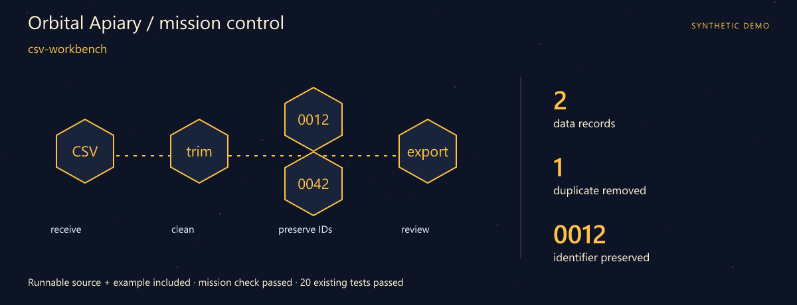
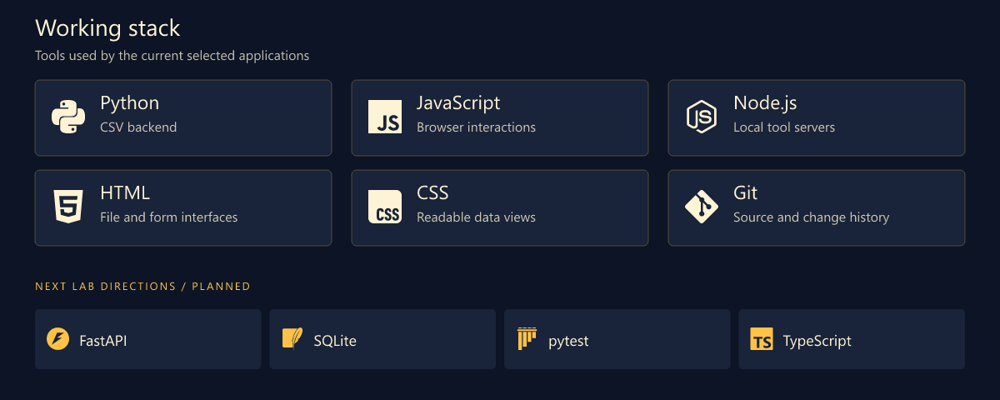
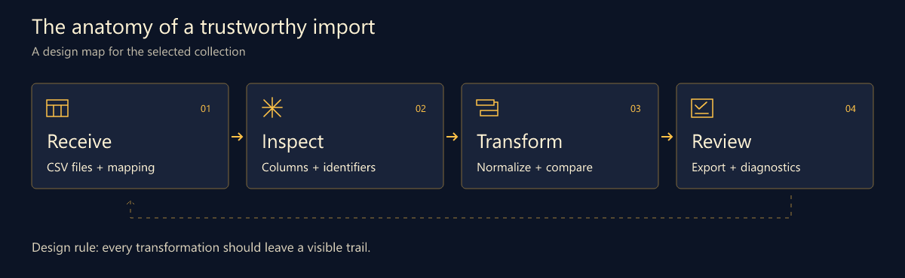
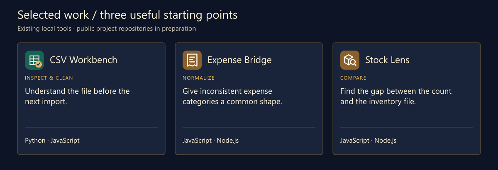

# Boba · Python Developer · Data Tools

> **Orbital Apiary** · A flight plan for messy data.

**From a messy export to a result you can explain.**

[Download the runnable mission](src/assets/launch.zip) · [Launch guide](src/LAUNCH.md) · [Working stack](#working-stack) · [Selected work](#selected-work)

## Mission control



**First launch: csv-workbench.** A complete source snapshot, synthetic example and assertion script are included. The mission check and **20 existing tests** passed. [Try the mission](src/LAUNCH.md) · [Snapshot and checked result](src/assets/launch.json).

I'm Boba. My corner of software is the space between receiving a file and trusting what comes out of it: parsing, cleanup, validation and the small interface that makes a transformation understandable.

A useful data tool should answer three questions quickly: what came in, what changed, and what needs another look. That is the thread connecting this collection.

## What I focus on

- **Data preparation.** CSV structure, category mappings and the path from raw rows to an export.
- **Validation that explains itself.** Identifiers, duplicate records and mismatched quantities deserve visible context.
- **Small interfaces for real files.** A focused screen, a review step and an output that can be inspected again.

## Working stack



The upper panel shows technologies used by the selected tools. The lower row is the next lab track.

## How I think about the work



## Selected work

Three existing local tools form this curated collection. Their public project repositories are being prepared.



| Project / stack | Why it belongs here | Input → output |
| --- | --- | --- |
| **CSV Workbench**<br>Python · JavaScript | Understand the file before the next import. Inspect and clean CSV records, review a table and export the result with a report. | **In:** CSV text or a UTF-8 file<br>**Out:** Cleaned CSV + JSON report |
| **Expense Bridge**<br>JavaScript · Node.js | Give inconsistent expense categories a common shape. Apply a category mapping to CSV expenses and inspect the normalized output. | **In:** Expense CSV + category map<br>**Out:** Normalized expense records |
| **Stock Lens**<br>JavaScript · Node.js | Find the gap between the count and the inventory file. Compare recorded and counted quantities from two CSV inputs. | **In:** Recorded + counted stock<br>**Out:** A stock comparison |

### A small input with a big consequence

```csv
sku,quantity
0012,7
0013,0
```

The leading zeros belong to the identifier. This synthetic input is the kind of case the next validation pass should make easy to inspect.

## Code and activity


These charts are rebuilt on a six-hour schedule after GitHub Pages is enabled. The observation time is printed on every chart. Commits are unique default-branch SHAs across all authors and owned public repositories, including forks. Language bytes describe repositories, not personal skill. Public interactions are a limited event feed (up to 300 events / 30 days), not visitor analytics. API and image caches may delay updates.

[Live data and scope](https://b9911.github.io/b9911/src/assets/live/metrics.json) · [Portfolio website](https://b9911.github.io/b9911/) · [Refresh setup](src/SETUP.md)

## Next lab

1. **Explain the row.** Point diagnostics back to the original row and field.
2. **Reuse the mapping.** Save a reviewed category mapping with an example input.
3. **Make the next import easier.** Explore a typed validation boundary and a small import history.

## Start a conversation

Bring an awkward CSV example, a surprising identifier or an import rule that deserves a clearer explanation. Synthetic samples work well.

[Open the profile repository's issues](https://github.com/b9911/b9911/issues) · [Browse the repositories](https://github.com/b9911?tab=repositories)

> 🔎 One more CSV edge case.

---

<sub>Fictional developer persona · AI-illustrated avatar. Curated tools retain original authors, licenses and commit history. Technology icons: Simple Icons.</sub>

[Artwork and data notes](src/assets/NOTICE.md)
